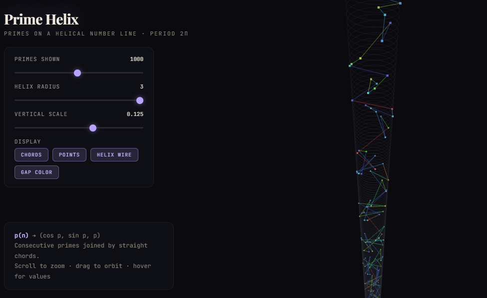
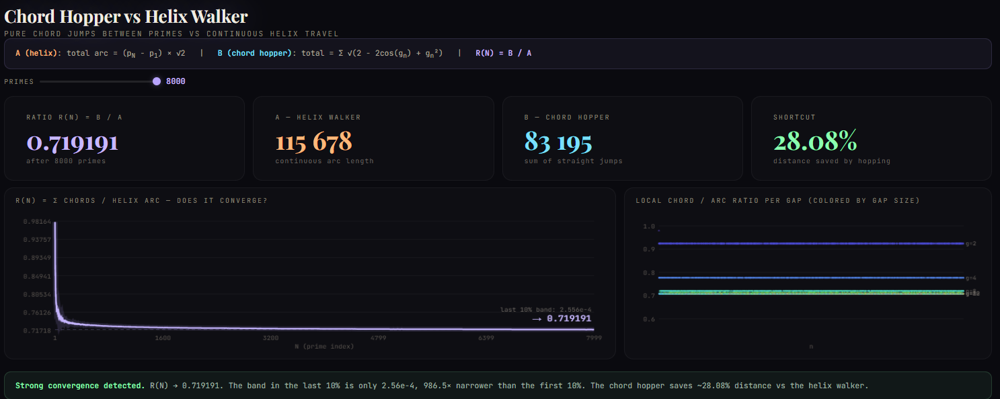
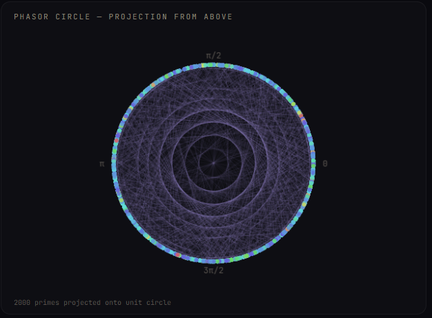
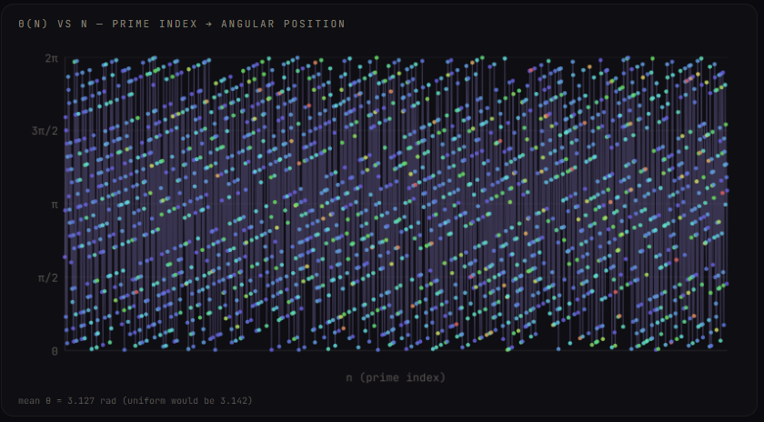
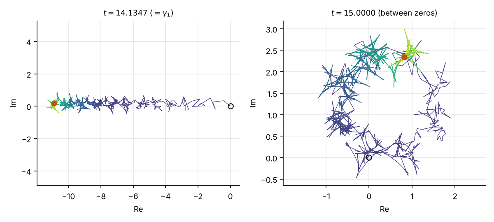

# Prime Helix

**A geometric exploration of prime distribution on Euler's helix: two particles, one ratio, the order of the gaps, and where the zeros of the Riemann zeta function appear.**

https://ninjas1337.github.io/Prime-Helix/
---

## What is this?

Euler's identity $e^{i\theta} = \cos\theta + i\sin\theta$ is usually shown as a circle. But if you let $\theta$ run freely in three dimensions, it becomes a helix: $(\cos t, \sin t, t)$.

This project places the prime numbers on that helix, connects consecutive primes with straight-line chords, and asks a simple question: if two particles travel at the same speed, one along the helix and the other hopping chord to chord between primes, what is the ratio of their paths?

The answer converges to $1/\sqrt{2} = \cos(45°)$, set by the helix geometry and the prime number theorem. The deviation from that limit measures small prime gaps. The order of the chords shows how consecutive gaps avoid repeating. The zeros of the zeta function do not appear on this helix, but on its logarithmic counterpart, where a walk over the primes resonates at $14.1347\ldots$, $21.0220\ldots$ and the rest.

## Interactive Visualizations

All visualizations are standalone HTML files. No build step: just open them in a browser.

### Prime Helix: 3D Visualization
Primes on the helix with connecting chords. Drag to orbit, scroll to zoom, hover for values. Uses Three.js.



`prime_helix.html`

---

### Chord Hopper vs Helix Walker
The two-particle experiment. Shows the convergence of R(N) toward 1/√2, local chord/arc ratios per gap, and summary metrics.



`prime_helix_ratio.html`

---

### Phasor Circle: Caustic Rings
Projection of the prime helix onto the unit circle. Chords between consecutive primes form concentric caustic rings, one per gap size g, at radius |cos(g/2)|.



`prime_phase_function.html` (left panel)

---

### Prime Phase Function: θ(n) vs n
The angular position of each prime on the phasor circle plotted against its index. Diagonal striations show runs of similar-sized gaps.



`prime_phase_function.html` (right panel)

---

### Prime Walk at the Zeta Zeros
Wind each prime power n by the angle t·ln n, give it length Λ(n)/√n and chain the arrows. Between zeros the walk tangles up; near a zero γ it follows an arc of radius 1/|t − γ|; at a zero it straightens into a line. Includes the resonance spectrum.



`prime_log_walk.html`

---

### Riemann Vortex
The prime helix spiraling onto the Riemann sphere via logarithmic projection.

`optimized_riemann_sphere.html`

## The Paper

> **The Prime Helix: A Geometric and Kinematic Translation of Prime Distribution Theory** (version 2, November 2026)

- `Prime Helix Paper.pdf`: compiled paper, version 2
- `prime_helix_paper.tex`: LaTeX source
- `Prime Helix Paper v1.pdf`: version 1 (March 2026), kept for reference

The paper presents the construction, derives the chord length formula, defines the two-particle experiment, measures how fast the ratio approaches its limit, describes the chord chain through the screw symmetry of the helix, compares it with random models of the primes, and shows the logarithmic walk in which the zeta zeros appear. It is expository: it does not prove new theorems about primes. Appendix A lists every change from version 1.

## Key Results

- **R(N) → 1/√2 ≈ 0.70711**: a consequence of the prime number theorem and the 45° pitch of the helix. The approach is slow: δ(N) = R(N) − 1/√2 decays like 1/ln² p_N (δ·ln² p_N ≈ 1.55 to 1.67 for p_N from 8·10⁴ to 9·10⁷). At 8000 primes, R = 0.719191.
- **One chord shape per gap**: by the screw symmetry of the helix, every chord's length and tilt depend only on its gap, and the whole chain is fixed by the gap sequence. Up to 10⁷: 664,576 chords, 74 shapes.
- **Random-model comparison**: Granville's model (Cramér's model plus sieving by small primes) reproduces the turn angles between chords and most of the avoidance of repeated gaps; for repeated gaps 24 and 30 the primes avoid repetition more strongly, consistent with the Lemke Oliver–Soundararajan bias.
- **Caustic rings**: projecting the chords onto the unit circle gives one ring per gap size, a visual histogram of gaps.
- **Zeta zeros on the logarithmic helix**: the smoothed walk over prime powers peaks at the first ten zeros of ζ (14.14, 21.02, 25.02, …).

## Limitations

This is an exploratory, expository work. The convergence of R(N) follows from elementary analysis once the prime number theorem is assumed, and δ(N) is dominated by small gaps, so it says nothing about the Riemann hypothesis. The phase function θ(n) = p_n mod 2π winds linearly in p and does not show the zeta zeros; those need logarithmic winding. Parallels with the Euler product, the pole at s = 1 and the critical line are analogies only.

## Reproducing the numbers

```
python3 analysis/prime_helix_checks.py
```

Needs numpy and matplotlib. Writes `analysis/results.txt` and the figures in `figures/`. Takes under a minute.

## Structure

```
prime-helix/
├── README.md
├── LICENSE
├── Prime Helix Paper.pdf          # Compiled paper, version 2
├── Prime Helix Paper v1.pdf       # Version 1, for reference
├── prime_helix_paper.tex          # LaTeX source, version 2
├── index.html                     # Landing page
├── prime_helix.html               # 3D helix visualization
├── prime_helix_ratio.html         # Two-particle convergence
├── prime_phase_function.html      # Phasor circle + phase function
├── prime_log_walk.html            # Logarithmic walk at the zeta zeros
├── optimized_riemann_sphere.html  # Riemann vortex
├── analysis/
│   ├── prime_helix_checks.py      # All numerical checks in the paper
│   └── results.txt                # Output of the script
├── figures/                       # Figures generated by the script
├── prime_helix.png                # Figure 1: 3D helix
├── fig_convergence.png            # Figure 2: R(N) convergence
├── fig_phasor.png                 # Figure 4: Caustic rings
└── fig_theta.png                  # Figure 5: Phase function
```

## License

This work is shared for academic and educational purposes. If you use it, a citation would be appreciated.
